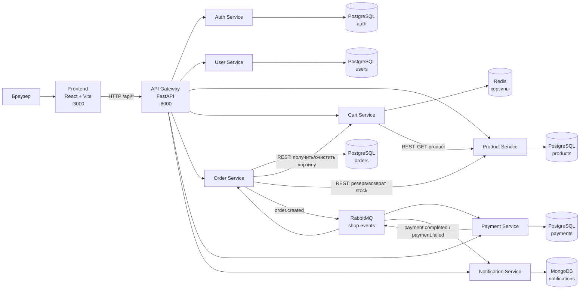
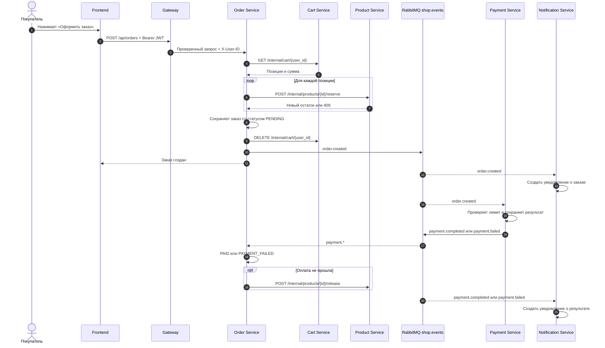
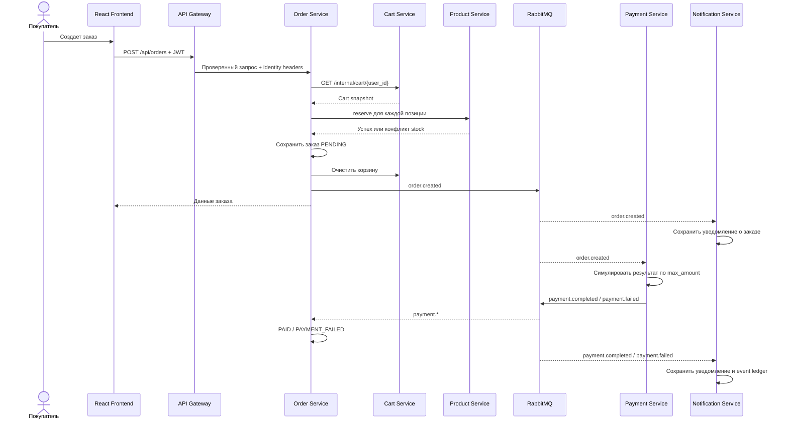

# E-commerce Microservices — документация проекта

Учебный интернет-магазин Nord построен как набор Python-микросервисов с
React-интерфейсом. Документ описывает фактические маршруты и поведение
реализации, а не функции, которые могли бы появиться в будущем.

> **Важно о данных и секретах.** Compose-конфигурация предназначена для
> локальной разработки: в ней нет объявленных именованных томов, а некоторые
> учетные данные имеют демонстрационные значения. Не используйте эту конфигурацию
> как production-развертывание. Не запускайте `docker compose down -v`, если
> важны данные. Перед демонстрацией задайте собственный `JWT_SECRET`; не
> публикуйте его и не вставляйте секреты в этот README.

## 1. О проекте

E-commerce (электронная коммерция) здесь означает каталог товаров, корзину,
оформление заказов, обработку результата оплаты и уведомления. Пользователь
работает с React-приложением; запросы к семи бизнес-сервисам направляются через
единый API Gateway.

В монолитном приложении эти обязанности находились бы в одной программе. Здесь
они разделены по бизнес-областям: например, складской остаток принадлежит
Product Service, а состояние заказа — Order Service. Это облегчает независимую
разработку, но добавляет межсервисные вызовы, сетевые ошибки и необходимость
согласовывать события.

### Технологии и их роль

| Технология | Роль в этом проекте |
|---|---|
| Python | Язык backend-сервисов и API Gateway. |
| FastAPI | HTTP API, проверка входных данных через Pydantic и автоматическая OpenAPI-документация сервисов. |
| PostgreSQL | Реляционные данные Auth, User, Product, Order и Payment. Compose создает для них отдельные PostgreSQL-сервисы. |
| Redis | Корзины пользователей; хэш Redis хранит позиции корзины. |
| MongoDB | Документы уведомлений и журнал обработанных событий. |
| RabbitMQ | Асинхронная передача событий заказа и результата оплаты. |
| Docker и Docker Compose | Сборка и запуск всего локального стека из 17 контейнеров. |
| React | Интерфейс магазина и состояние пользовательской сессии. |
| TypeScript | Типы API-ответов и проверка frontend-кода при сборке. |
| Vite | Dev-сервер и сборщик frontend. |
| Tailwind CSS | Utility-классы оформления интерфейса. |
| Axios | HTTP-клиент frontend; общая конфигурация находится в `frontend/src/api/client.ts`. |
| React Router | Маршруты страниц магазина. |
| pytest и httpx | Автоматические изолированные API/unit-тесты backend и Gateway. |

## 2. Архитектура проекта

**Микросервис** — небольшой сервис с отдельной бизнес-ответственностью и
собственным API. В этом проекте семь сервисов не являются инфраструктурой:
PostgreSQL, Redis, MongoDB и RabbitMQ — зависимости, а не дополнительные
бизнес-сервисы.



### Как читать схему

1. Браузер загружает Frontend с порта `3000`.
2. Frontend отправляет API-запросы только в Gateway на `8000`.
3. Gateway проверяет JWT для защищенных маршрутов и проксирует запрос к
   нужному сервису.
4. Сервисы могут вызывать друг друга синхронно по REST. Например, Cart Service
   получает данные товара у Product Service, а Order Service получает корзину и
   резервирует товары.
5. Результат обработки заказа передается через RabbitMQ. Отправитель не должен
   ждать, пока все подписчики закончат свою работу.
6. Каждый сервис владеет своим хранилищем. Сервисы не читают таблицы друг друга.

В Compose сервисы не публикуют свои API-порты на host. Они доступны внутри
создаваемой Compose-сети по именам, например `http://product-service:8000`.
Снаружи опубликованы только Frontend, Gateway и RabbitMQ.

## 3. Структура репозитория

```text
.
├── docker-compose.yml
├── pytest.ini
├── README.md
├── gateway/
│   ├── Dockerfile
│   ├── requirements.txt
│   └── app/
│       ├── main.py
│       ├── routes.py
│       ├── proxy.py
│       ├── auth.py
│       ├── middleware.py
│       ├── config.py
│       └── logging_config.py
├── services/
│   ├── auth-service/
│   ├── user-service/
│   ├── product-service/
│   ├── cart-service/
│   ├── order-service/
│   ├── payment-service/
│   └── notification-service/
│       └── app/
│           ├── main.py
│           ├── models.py
│           ├── schemas.py
│           ├── db.py
│           ├── events.py
│           ├── config.py
│           └── common.py
├── frontend/
│   ├── Dockerfile
│   ├── package.json
│   ├── package-lock.json
│   ├── vite.config.ts
│   ├── tailwind.config.cjs
│   └── src/
│       ├── api/
│       ├── components/
│       ├── context/
│       ├── pages/
│       ├── types/
│       ├── utils/
│       ├── App.tsx
│       └── main.tsx
└── tests/
    ├── Dockerfile
    ├── requirements.txt
    ├── conftest.py
    ├── support/
    └── unit/
```

- `gateway/` — единая внешняя точка входа, аутентификация запросов, прокси,
  CORS, лимит запросов и OpenAPI Gateway.
- `services/` — семь бизнес-сервисов. Обычно `main.py` содержит маршруты и
  основную логику, `models.py` — модели хранения, `schemas.py` — API-схемы,
  `db.py` — подключение к хранилищу. Не у каждого сервиса есть все эти файлы:
  Cart использует Redis, а не SQLAlchemy; RabbitMQ-код есть у Order, Payment и
  Notification. У сервисов также есть собственные `Dockerfile` и
  `requirements.txt`.
- `frontend/` — React-приложение. API-клиенты отделены от страниц в `src/api/`.
- `tests/` — pytest-тесты и безопасная тестовая инфраструктура; настоящего
  integration-набора с Docker-сервисами там нет.
- `docker-compose.yml` — конфигурация 17 контейнеров и их внутренних адресов.
- `pytest.ini` — test path и маркеры `unit`/`integration`.
- `README.md` — эта документация.
- `docs/` и `infrastructure/` присутствуют в корне, но в текущем дереве не
  содержат основной реализации приложения.

## 4. Семь бизнес-микросервисов

### 4.1 Auth Service

**Назначение.** Регистрирует учетные записи, проверяет пароль при входе и выдает
JWT. Хранит учетную запись и роль, но не профиль покупателя.

**Хранение и модели.** PostgreSQL database `auth`, таблица `accounts`.
`Account` содержит `id`, уникальный `email`, `password_hash` и `role` (по
умолчанию `user`). Пароль хешируется bcrypt; исходный пароль не сохраняется.
`Credentials` проверяет email регулярным выражением и пароль длиной 6–72
символа. `TokenOut` содержит `access_token` и `token_type`; `VerifyOut` —
`user_id` и `role`.

**Основная логика.**

- `make_token(acc)` создает HS256 JWT с `sub`, `role` и `exp`; срок по умолчанию
  задается `jwt_expire_minutes` и равен 60 минутам.
- `register(data, db)` нормализует email в нижний регистр, хеширует пароль,
  сохраняет аккаунт и выдает токен. Повторный email дает `409`.
- `login(data, db)` ищет аккаунт и сравнивает bcrypt-хеш; неверные данные дают
  `401`.
- `verify(authorization)` декодирует Bearer JWT и возвращает идентификатор и
  роль; невалидный/просроченный JWT дает `401`.
- `health()` сообщает о работе процесса; `ready(db)` выполняет `SELECT 1` и
  возвращает `503`, если PostgreSQL недоступен.
- Lifespan создает таблицы через SQLAlchemy `create_all` и повторяет попытки
  подключения при старте. Отдельных миграций Alembic в проекте нет.

| Метод и маршрут | Доступ | Назначение и важные ответы |
|---|---|---|
| `POST /api/auth/register` | Публичный | Регистрация; `201`, дубликат `409`, ошибочная схема `422`. |
| `POST /api/auth/login` | Публичный | Вход; `200` с токеном или `401`. |
| `GET /api/auth/verify` | В Gateway защищен JWT | Проверка токена и получение `user_id`/`role`; `401` при ошибке. |
| `GET /health`, `GET /ready` | Служебные | Liveness процесса и готовность PostgreSQL. |

**Пример.** Клиент отправляет `email` и пароль на регистрацию. Auth Service
возвращает JWT. Frontend сохраняет его в session storage и отправляет как
`Authorization: Bearer <JWT>` при последующих запросах.

> В Compose есть значение JWT по умолчанию для локального запуска. Оно не
> подходит для публичной демонстрации: задайте случайный `JWT_SECRET` и
> используйте одно и то же значение для Auth Service и Gateway.

### 4.2 User Service

**Назначение.** Хранит профиль, отделенный от учетных данных Auth Service.
Связь между сервисами логическая: `Profile.user_id` равен ID аккаунта, но
между разными PostgreSQL-базами нет общего внешнего ключа.

**Хранение и модели.** PostgreSQL database `users`, таблица `profiles`.
`Profile` содержит `user_id`, `full_name`, `phone`, `address`.
`ProfileIn` ограничивает длину полей и формат телефона; `ProfileOut` добавляет
`user_id`.

**Основная логика.**

- `current_user_id(x_user_id)` читает identity-заголовок, который по контракту
  устанавливает Gateway после JWT-проверки; отсутствие корректного ID дает
  `401`.
- `get_or_create(db, user_id)` создает пустой профиль при первом запросе.
- `get_me()` возвращает профиль текущего пользователя.
- `update_me(data, user_id, db)` обновляет поля профиля и сохраняет их.
- `get_user(target_id, user_id, x_user_role, db)` разрешает читать чужой профиль
  только роли `admin`; ответы `403` и `404` используются для отказа/отсутствия.
- `health()` и `ready(db)` проверяют процесс и PostgreSQL.

| Метод и маршрут | Доступ | Назначение |
|---|---|---|
| `GET /api/users/me` | JWT | Получить или создать собственный профиль. |
| `PUT /api/users/me` | JWT | Обновить `full_name`, `phone`, `address`; ошибки схемы — `422`. |
| `GET /api/users/{target_id}` | JWT; чужой профиль — только admin | Получить профиль; `403`/`404`. |
| `GET /health`, `GET /ready` | Служебные | Проверки процесса и PostgreSQL. |

**Пример.** При открытии `/api/users/me` профиль может быть создан лениво, даже
если пользователь до этого не заполнял его.

### 4.3 Product Service

**Назначение.** Владеет карточками товаров и остатками. Каталог читается
публично; изменение каталога доступно роли `admin`.

**Хранение и модели.** PostgreSQL database `products`, таблица `products`.
`Product` имеет `id`, `name`, `description`, `price`, `stock`, `image_url`.
`ProductIn` требует непустое имя, цену `> 0`, остаток `>= 0`; `ProductOut`
добавляет ID. При старте, если таблица пуста, `lifespan` добавляет шесть
демонстрационных товаров из `DEMO`.

**Основная логика.**

- `require_admin()` проверяет `X-User-Role`; этот заголовок должен быть
  сформирован Gateway из проверенного JWT.
- `get_or_404(db, product_id)` ищет товар или возвращает `404`.
- `list_products(q, limit, offset, db)` ищет по имени, сортирует по ID и
  ограничивает страницу; `limit` не может быть больше 100.
- `get_product()` возвращает карточку товара.
- `create_product()`, `update_product()` и `delete_product()` управляют
  каталогом; создание — `201`, удаление — `204`.
- `reserve(product_id, data, db)` атомарно уменьшает остаток, если товара
  достаточно; иначе возвращает `409`.
- `release(product_id, data, db)` возвращает количество на склад.
- `health()` и `ready(db)` проверяют приложение и PostgreSQL.

| Метод и маршрут | Доступ | Назначение |
|---|---|---|
| `GET /api/products?q=&limit=&offset=` | Публичный | Список и поиск товаров. |
| `GET /api/products/{product_id}` | Публичный | Карточка товара; `404`, если не найдена. |
| `POST /api/products` | Admin | Создание, `201`; валидация — `422`. |
| `PUT /api/products/{product_id}` | Admin | Полная замена полей товара. |
| `DELETE /api/products/{product_id}` | Admin | Удаление, `204`. |
| `POST /internal/products/{product_id}/reserve` | Внутренний вызов Order | Резерв товара; `409` при нехватке. |
| `POST /internal/products/{product_id}/release` | Внутренний вызов Order | Возврат зарезервированного остатка. |
| `GET /health`, `GET /ready` | Служебные | Проверки процесса и PostgreSQL. |

**Пример.** Корзина проверяет наличие товара через `GET /api/products/{id}`.
При оформлении Order Service вызывает внутренний маршрут `reserve`, а не
изменяет Product Service database напрямую.

### 4.4 Cart Service

**Назначение.** Управляет корзинами пользователей и проверяет, что выбранный
товар существует и его количество доступно.

**Хранение и модели.** Redis database `0`. `key(user_id)` формирует ключ
`cart:<user_id>`; позиции лежат в Redis hash, значение позиции — JSON с
названием, ценой и количеством. `AddItem` требует `product_id > 0` и
`1 <= quantity <= 99`; `CartOut` содержит `items` и `total`.

**Основная логика.**

- `current_user_id()` получает identity из Gateway-заголовка.
- `fetch_product(product_id)` делает REST GET к Product Service. Таймаут дает
  `504`, сетевой сбой — `502`, отсутствующий товар — `404`.
- `build_cart(user_id)` читает Redis hash, сортирует позиции и считает сумму.
- `get_cart()`, `add_item()`, `remove_item()` и `clear_cart()` реализуют
  пользовательские операции. Повторное добавление увеличивает количество;
  превышение остатка дает `409`.
- `internal_get(user_id)` и `internal_clear(user_id)` используются
  Order Service; они не являются частью публичного frontend API.
- Обработчик `redis_error` возвращает `503`, если Redis недоступен.
- `ready()` проверяет Redis командой `PING`; `health()` проверяет процесс.

| Метод и маршрут | Доступ | Назначение |
|---|---|---|
| `GET /api/cart` | JWT | Получить корзину; пустая корзина — `items: []`, `total: 0`. |
| `POST /api/cart/items` | JWT | Добавить/увеличить позицию; `404` товар, `409` остаток, `422` данные. |
| `DELETE /api/cart/items/{product_id}` | JWT | Удалить позицию; `404`, если ее нет. |
| `DELETE /api/cart` | JWT | Очистить корзину, `204`. |
| `GET /internal/cart/{user_id}` | Внутренний вызов Order | Получить корзину для заказа. |
| `DELETE /internal/cart/{user_id}` | Внутренний вызов Order | Очистить корзину после оформления. |
| `GET /health`, `GET /ready` | Служебные | Проверки процесса и Redis. |

**Пример.** `POST /api/cart/items` с `product_id` и `quantity` сначала получает
актуальную карточку товара по REST, затем проверяет stock и сохраняет позицию в
Redis. Цены хранятся в snapshot корзины; Order Service использует эти данные
при создании заказа.

### 4.5 Order Service

**Назначение.** Оркестрирует оформление заказа: получает корзину, резервирует
товары, сохраняет заказ, очищает корзину и публикует событие.

**Хранение и модели.** PostgreSQL database `orders`, таблицы `orders` и
`order_items`. `Order` содержит пользователя, сумму, статус, время и позиции.
`OrderItem` хранит snapshot `product_id`, имя, цену и количество.
Первоначальный статус — `PENDING`.

**Основная логика.**

- `current_user_id()` читает пользователя, добавленный Gateway.
- `call(method, url, **kw)` вызывает соседние сервисы по HTTP, передает
  `X-Request-ID`; таймаут преобразует в `504`, сетевую ошибку — в `502`.
- `release(items)` компенсирует ранее успешные резервы, вызывая Product Service.
- `get_order_or_404(db, order_id, user_id, role)` проверяет наличие и право
  пользователя видеть заказ.
- `create_order(user_id, db)` получает внутреннюю корзину, отклоняет пустую
  (`400`), резервирует каждый товар, сохраняет заказ, очищает корзину и
  публикует `order.created`. При нехватке остатка возвращается `409`, а
  предыдущие резервы компенсируются. Ошибка сохранения дает `503`.
- `my_orders()` возвращает заказы текущего пользователя.
- `get_order()` проверяет владельца или роль `admin`.
- `cancel_order()` отменяет только `PENDING`, возвращает остаток и публикует
  `order.cancelled`. Для другого статуса — `409`.
- `handle_payment_event(routing_key, data)` меняет статус `PENDING` заказа на
  `PAID` или `PAYMENT_FAILED`; при неуспехе оплаты освобождает товары.
- `health()` и `ready(db)` проверяют процесс и PostgreSQL.
- В `events.py` `publish(routing_key, payload)` публикует событие, а
  `start_consumer(handle_payment_event)` слушает платежные результаты.

| Метод и маршрут | Доступ | Назначение |
|---|---|---|
| `POST /api/orders` | JWT | Создать заказ из корзины; `201`, пустая корзина `400`, stock conflict `409`. |
| `GET /api/orders` | JWT | Список заказов текущего пользователя. |
| `GET /api/orders/{order_id}` | JWT | Заказ владельца или admin; `403`/`404`. |
| `POST /api/orders/{order_id}/cancel` | JWT | Отменить только `PENDING`; иначе `409`. |
| `GET /health`, `GET /ready` | Служебные | Проверки процесса и PostgreSQL. |

**Пример.** Order Service не обращается к Redis напрямую: корзину и ее очистку
он запрашивает у Cart Service по внутреннему REST API. Аналогично остатки
изменяются только через Product Service.

### 4.6 Payment Service

**Назначение.** Обрабатывает `order.created`, записывает результат и отправляет
событие-ответ. Это **симуляция** оплаты, а не подключение к банку или
платежному провайдеру.

**Хранение и модели.** PostgreSQL database `payments`, таблица `payments`.
`Payment` хранит `order_id` (уникальный), `user_id`, `amount`, `status`,
`reason`, `created_at`.

**Основная логика.**

- `handle_order_created(data)` берет `order_id`, `user_id`, `total`; дубликат
  заказа пропускает. При сумме выше `settings.max_amount` (по умолчанию 3000)
  записывает `FAILED`, иначе `COMPLETED`, после чего публикует событие результата.
- `get_payment(order_id, ...)` отдает статус владельцу или admin; без identity
  возвращает `401`, для чужого платежа `403`, для отсутствующего `404`.
- В `events.py` `start_consumer(handler)` подписывает очередь на
  `order.created`; `publish(routing_key, payload)` публикует persistent
  JSON-сообщение; `check_connection()` проверяет соединение с RabbitMQ.
- `health()` проверяет процесс; `ready(db)` проверяет PostgreSQL и RabbitMQ.

| Метод и маршрут | Доступ | Назначение |
|---|---|---|
| `GET /api/payments/order/{order_id}` | JWT | Состояние платежа по заказу. |
| `GET /health`, `GET /ready` | Служебные | Проверки приложения, PostgreSQL и RabbitMQ. |

**Пример.** При сумме ниже порога создается `COMPLETED`, при превышении —
`FAILED` с причиной `Amount exceeds limit`. Ни номер карты, ни реальные
платежные данные сервис не принимает.

### 4.7 Notification Service

**Назначение.** Преобразует известные бизнес-события в уведомления и дает
пользователю API для чтения, отметки прочтения и удаления.

**Хранение и модели.** MongoDB database `notifications`; коллекции
`notifications` и `processed_events`. Для уведомлений создаются уникальный
индекс `event_key` и индексы для списка по пользователю/дате и непрочитанным
уведомлениям. `NotificationDocument` описывает документ; `NotificationOut` —
API-ответ.

**Основная логика.**

- `models.from_event(event_type, payload)` принимает только
  `order.created`, `payment.completed`, `payment.failed`, валидирует ID и сумму,
  создает текст на русском и идемпотентный ключ `<event_type>:<order_id>`.
- `handle_event(event_type, payload)` отмечает событие в `processed_events`,
  не создает повторное уведомление для уже обработанного event key и сохраняет
  новый документ.
- `current_user_id()` требует положительный `X-User-ID`.
- `list_notifications(user_id, unread_only, limit, skip)` выбирает документы,
  сортирует по дате и применяет пагинацию.
- `to_response(document)` преобразует Mongo `_id` в строковый API `id`.
- `get_notifications()` и `get_unread_notifications()` возвращают списки.
- `mark_as_read()` проверяет ObjectId и владельца, затем ставит `is_read`.
- `delete_notification()` удаляет только документ текущего пользователя.
- `mongo_error()` возвращает `503` при ошибках MongoDB; `ready()` проверяет
  MongoDB и RabbitMQ; `health()` проверяет процесс.
- `events.start_consumer(handle_event)` подписывает consumer на три события;
  `events.check_connection()` проверяет соединение с RabbitMQ.

| Метод и маршрут | Доступ | Назначение |
|---|---|---|
| `GET /api/notifications?limit=&skip=` | JWT | Список уведомлений пользователя; limit 1–100. |
| `GET /api/notifications/unread?limit=&skip=` | JWT | Только непрочитанные. |
| `PATCH /api/notifications/{notification_id}/read` | JWT | Отметить свое уведомление прочитанным. |
| `DELETE /api/notifications/{notification_id}` | JWT | Удалить свое уведомление, `204`. |
| `GET /health`, `GET /ready` | Служебные | Проверки процесса, MongoDB и RabbitMQ. |

**Пример.** Два одинаковых события `payment.completed` для одного заказа
должны приводить к одному уведомлению. В текущем Frontend нет страницы или
клиентского API-модуля уведомлений; этот API доступен через Gateway/Swagger.

## 5. API Gateway

Gateway — опубликованная внешняя точка входа (`localhost:8000`). Frontend не
вызывает сервисы напрямую. `gateway/app/routes.py` регистрирует прокси для
префиксов `/api/auth`, `/api/users`, `/api/products`, `/api/cart`,
`/api/orders`, `/api/payments`, `/api/notifications` и методов GET, POST, PUT,
PATCH, DELETE.

### Обработка запроса

1. `middleware.py` получает `X-Request-ID`; если это не UUID, создает UUID.
2. Middleware применяет ограничение запросов по IP. По умолчанию это 120
   запросов за 60 секунд; `/health`, `/ready`, Swagger и OPTIONS исключены.
3. `proxy.py` определяет сервис назначения и публичность маршрута.
4. Для защищенного запроса `auth.py` проверяет HS256 JWT с обязательными
   `exp`, `sub`, `role`. `sub` должен быть положительным числовым ID.
5. Публичны только POST регистрации/входа и GET каталога товаров/карточек.
   Остальные `/api/*` требуют Bearer JWT.
6. Запись/изменение товара дополнительно требует роль `admin`.
7. Перед отправкой Gateway удаляет присланные клиентом `X-User-ID`,
   `X-User-Role` и `X-Request-ID`, затем добавляет identity из проверенного JWT
   и request ID. Поэтому API-клиент не может назначить себе чужую роль, просто
   отправив заголовок.
8. Gateway передает запрос через общий `httpx.AsyncClient`, включая тело и
   query string, и возвращает ответ, добавляя request ID.

Сервисы используют identity-заголовки, переданные Gateway. Не публикуйте их
напрямую в интернет и не считайте клиентские `X-User-ID`/`X-User-Role`
доверенными вне Gateway.

Важные функции реализации: `register_routes()` регистрирует API-шаблоны,
`_make_endpoint()` создает proxy endpoint, `is_public_endpoint()` определяет
публичные маршруты, `authenticate()` создает проверенный principal,
`require_admin()` проверяет роль, `proxy_request()` пересылает запрос,
`_request_headers()` фильтрует и формирует заголовки, `_response()` фильтрует
ответ upstream. `add_gateway_middleware()` подключает middleware, а
`InMemoryRateLimiter.allow()` проверяет лимит по IP. Lifespan Gateway создает и
закрывает общий `httpx.AsyncClient`.

### Ошибки, логи и CORS

- Gateway timeout — `504`, недоступное upstream-соединение — `503`, другая
  ошибка HTTP-клиента — `502`.
- HTTP-ошибки возвращают JSON с `error` и `request_id`; ошибки валидации —
  `422` с `details`; необработанная ошибка отдает клиенту `500` без traceback.
- Middleware журналирует ID запроса, метод, путь, статус и длительность.
- CORS разрешает origins из `CORS_ORIGINS`; wildcard `*` запрещен при
  включенных credentials.
- Лимитер хранит счетчики только в памяти одного Gateway-процесса. Для
  нескольких экземпляров нужна общая система хранения; сейчас распределенного
  лимитера нет.

**Реальные примеры:**

```text
GET  http://localhost:8000/api/products?q=ноутбук
POST http://localhost:8000/api/auth/login
GET  http://localhost:8000/api/orders
GET  http://localhost:8000/api/payments/order/1
```

Последние два запроса требуют заголовок `Authorization: Bearer <JWT>`.
`gateway/app/main.py` создает HTTP-клиент и обрабатывает ошибки; `routes.py`
регистрирует прокси; `auth.py` проверяет principal/роль; `proxy.py` выполняет
forwarding; `middleware.py` отвечает за request ID и rate limit.

## 6. Базы данных и владение данными

В микросервисной архитектуре сервис является владельцем своих данных. Другой
сервис получает их через REST или событие, а не подключается к чужой базе.
Это уменьшает связанность и позволяет менять схему в пределах ответственности
сервиса.

| Сервис | Хранилище и конфигурация Compose | Что хранится | Почему подходит |
|---|---|---|---|
| Auth Service | PostgreSQL, database `auth`, контейнер `auth-db` | Учетные записи и хеши паролей | Реляционные записи, уникальность email. |
| User Service | PostgreSQL, database `users`, контейнер `user-db` | Профили покупателей | Структурированные поля профиля. |
| Product Service | PostgreSQL, database `products`, контейнер `product-db` | Товары и stock | Карточки товара и атомарное изменение остатка. |
| Order Service | PostgreSQL, database `orders`, контейнер `order-db` | Заказы и позиции | Связанные сущности, статусы и snapshot заказа. |
| Payment Service | PostgreSQL, database `payments`, контейнер `payment-db` | Итог симулированной оплаты | Уникальность `order_id` защищает от дублирования записи. |
| Cart Service | Redis DB `0`, контейнер `cart-db` | Хэши `cart:<user_id>` | Быстрое чтение и обновление краткоживущей корзины. |
| Notification Service | MongoDB database `notifications`, контейнер `notification-db` | `notifications`, `processed_events` | Документ уведомления и журнал идемпотентности. |

Это действительно отдельные Compose-сервисы PostgreSQL для пяти областей, а не
пять баз внутри одного контейнера PostgreSQL. MongoDB и Redis также имеют
отдельные контейнеры.

В `docker-compose.yml` не объявлены именованные `volumes`. Не делайте вывод, что
данные имеют настроенную резервную копию или одинаково переживут любые
пересоздания контейнеров. Для обычной остановки используйте `docker compose
stop`; не запускайте `down -v`, если не готовы удалить тома с данными.

## 7. REST и синхронное взаимодействие

REST — стиль API поверх HTTP, где маршрут описывает ресурс, а метод — действие:

| Метод | Обычное значение | Пример в проекте |
|---|---|---|
| GET | Прочитать | `GET /api/products` |
| POST | Создать или выполнить действие | `POST /api/orders` |
| PUT | Обновить ресурс целиком | `PUT /api/users/me` |
| PATCH | Частично изменить | `PATCH /api/notifications/{id}/read` |
| DELETE | Удалить/очистить | `DELETE /api/cart` |

Фактические синхронные межсервисные вызовы:

| Кто вызывает | Куда | Зачем |
|---|---|---|
| Frontend | API Gateway `/api/*` | Внешний доступ к backend; вся работа идет через Gateway. |
| Cart Service | Product Service `GET /api/products/{id}` | Проверить существование и stock товара перед добавлением. |
| Order Service | Cart Service `GET /internal/cart/{user_id}` | Получить snapshot корзины. |
| Order Service | Product Service `POST /internal/products/{id}/reserve` | Зарезервировать позиции. |
| Order Service | Cart Service `DELETE /internal/cart/{user_id}` | Очистить корзину после создания заказа. |
| Order Service | Product Service `POST /internal/products/{id}/release` | Компенсировать резерв при ошибке, отмене или неуспешной оплате. |

### Пример: оформление заказа

1. Frontend делает `POST /api/orders` через Gateway с JWT.
2. Order Service получает корзину через Cart Service.
3. Для каждой позиции Order Service вызывает Product Service и резервирует stock.
4. Если резерв одной позиции не проходит (`409`), Order Service пытается
   освободить уже зарезервированные позиции.
5. После успешного резерва сохраняется `Order` и его `OrderItem` в своей
   PostgreSQL database.
6. Корзина очищается отдельным HTTP-запросом к Cart Service.
7. Затем Order Service публикует `order.created` в RabbitMQ.

Это не одна транзакция между тремя базами. Используются последовательные
запросы и компенсирующий вызов `release`; поведение при полном отказе
зависимостей ограничено обработчиками ошибок.

## 8. RabbitMQ и асинхронные события

Message broker (брокер сообщений) принимает сообщение от производителя
(producer) и доставляет его подписанным потребителям (consumer). Producer не
ждет, пока каждый consumer завершит обработку. REST, наоборот, обычно ждет
HTTP-ответа вызываемого сервиса.

В проекте используется durable topic exchange `shop.events`; сообщения
публикуются как persistent JSON. Queue — очередь получателя; routing key
указывает тип события:

| Producer / consumer | Queue | Binding / routing key | Результат |
|---|---|---|---|
| Order Service публикует | — | `order.created` | Создан и сохранен заказ. |
| Payment Service слушает | `payment.order-events` | `order.created` | Записывает `COMPLETED` или `FAILED`. |
| Payment Service публикует | — | `payment.completed` или `payment.failed` | Передает результат. |
| Order Service слушает | `order.payment-events` | `payment.*` | Устанавливает `PAID` или `PAYMENT_FAILED`. |
| Notification Service слушает | `notification.events` | `order.created`, `payment.completed`, `payment.failed` | Создает уведомления. |

### Последовательность событий



### ACK, NACK и поведение при сбоях

- ACK подтверждает успешную обработку сообщения.
- NACK сообщает о неудаче. В Payment и Order исключение приводит к
  `requeue=False`; без настроенной dead-letter очереди такое сообщение не
  возвращается в очередь.
- Notification Service отклоняет некорректный JSON/событие без повторной
  доставки, а неожиданную ошибку обработки отправляет на повтор с
  `requeue=True`.
- `handle_event()` Notification Service дедуплицирует события через
  `processed_events` и `event_key`.

В проекте нет transactional outbox: если Order Service сохранит заказ, но не
сможет опубликовать `order.created`, он логирует ошибку, а заказ остается
созданным. Это важное ограничение для защиты проекта. Не все события
уведомляются: Notification слушает только три указанных routing key; например,
`order.cancelled` не входит в список.

### RabbitMQ Management UI

Compose публикует:

- AMQP: `localhost:5672`;
- Management UI: `http://localhost:15672`.

В Compose не задаются отдельные RabbitMQ user/password: внутренний AMQP URL
сервисов использует стандартные демонстрационные учетные данные `guest:guest`.
Не считайте их production-секретом и не открывайте такой доступ в публичную
сеть. HTTP-страница Management UI отвечала `200`; вход в UI отдельно не
проверялся. В интерфейсе можно изучать exchanges, queues, bindings, consumers,
соединения и rates сообщений. Не удаляйте очереди в интерфейсе, если не
понимаете последствий.

## 9. Frontend

Приложение находится в `frontend/src/`. React Router настроен в `App.tsx`,
точка входа — `main.tsx`, где создаются `BrowserRouter` и `AuthProvider`.

| Путь в браузере | Страница | Доступ |
|---|---|---|
| `/` | `CatalogPage` | Публично |
| `/products/:id` | `ProductPage` | Публично |
| `/login` | `AuthForm` в режиме входа | Гости |
| `/register` | `AuthForm` в режиме регистрации | Гости |
| `/cart` | `CartPage` | Требует входа |
| `/orders` | `OrdersPage` | Требует входа |
| `/orders/:id` | `OrderDetailsPage` | Требует входа |
| `/profile` | `ProfilePage` | Требует входа |

`Header`, `ProductCard`, `StatusBadge`, `AppLayout`, `ProtectedRoute` и
`LoadingState` — повторно используемые компоненты. Типы ответов лежат в
`src/types/api.ts`; функции API разделены по файлам в `src/api/`.

### Сессия и запросы

- `AuthContext` предоставляет `signIn`, `signUp`, `signOut`, `identity`.
- JWT сохраняется в `sessionStorage` под ключом `nord_access_token`. Это
  хранение в браузерной сессии, а не HttpOnly cookie.
- При запуске приложение проверяет уже сохраненный JWT через `/api/auth/verify`.
  При `401` Axios interceptor удаляет токен и сообщает контексту об истекшей
  сессии.
- Общий Axios instance в `src/api/client.ts` использует
  `VITE_API_URL` (fallback `http://localhost:8000`), таймаут 15 секунд и
  автоматически добавляет Bearer-токен.
- Ошибки преобразуются `getErrorMessage()` в `src/utils/errors.ts`.
  Каталог, карточка товара, корзина, заказы и профиль показывают состояния
  загрузки, ошибки или пустого результата.

### Фактический пользовательский сценарий

1. Регистрация или вход на `/register`/`/login`.
2. Просмотр и поиск каталога; открытие карточки товара.
3. После входа — добавление товара в Redis-корзину, изменение количества,
   удаление позиции и просмотр суммы.
4. Нажатие «Оформить заказ» создает заказ и открывает `/orders/:id`.
5. Страница заказа показывает статус и, если Payment Service уже обработал
   событие, статус платежа. Пока результата нет, страницу можно обновить.
6. Владелец может отменить заказ только в статусе `PENDING`.
7. Профиль можно просматривать и менять.

**Не реализовано в интерфейсе:** страница уведомлений и frontend-клиент
Notification API; админская форма управления товарами; реальный платежный
провайдер. Backend-маршруты для уведомлений и CRUD товаров существуют, но это
не означает наличие соответствующих экранов или способа создать admin через
публичную регистрацию.

### Запуск frontend отдельно

Нужны Node.js 22 (Dockerfile использует `node:22-alpine`) и npm. В PowerShell:

```powershell
Set-Location .\frontend
Copy-Item .env.example .env.local
npm ci
npm run dev
```

`.env.example` задает `VITE_API_URL=http://localhost:8000`. Для production build:

```powershell
npm run build
```

Скрипта frontend-тестов в `package.json` нет. Убедитесь, что Gateway запущен,
иначе запросы приложения не смогут завершиться.

## 10. Swagger и OpenAPI

OpenAPI — машиночитаемое описание HTTP API; Swagger UI — веб-интерфейс,
который позволяет изучать маршруты и отправлять запросы.

| Что открыть | Адрес | Доступ с host |
|---|---|---|
| Swagger UI Gateway | `http://localhost:8000/docs` | Да |
| ReDoc Gateway | `http://localhost:8000/redoc` | Да |
| OpenAPI Gateway | `http://localhost:8000/openapi.json` | Да |
| Swagger отдельного сервиса | `http://<compose-service-name>:8000/docs` | Только внутри Compose-сети; порт сервиса не опубликован на host. |

Swagger Gateway и OpenAPI проверены по HTTP (`200`). FastAPI-сервисы также
используют стандартные URL `/docs`, `/redoc`, `/openapi.json`, но отдельные
`localhost:<port>` для них не настроены. В Swagger Gateway описывает общие
прокси-маршруты и универсальные тела запросов, а не полную схему каждой
микрослужбы; окончательная валидация выполняется целевым сервисом.

### Как проверить маршрут в Swagger

1. Откройте `http://localhost:8000/docs`.
2. Найдите тег сервиса и нужный HTTP-метод.
3. Для защищенного маршрута сначала выполните регистрацию/вход и скопируйте
   полученный JWT.
4. Нажмите **Authorize** и вставьте токен. Не публикуйте его.
5. Нажмите **Try it out**, заполните параметры или JSON-тело согласно
   фактической схеме сервиса.
6. Нажмите **Execute** и изучите status code и JSON-ответ.

Публичные запросы — регистрация, вход и GET каталога. Остальные `/api/*`
запросы требуют токен; изменение товаров дополнительно требует роль admin.

## 11. Как запустить проект (Windows)

### Требования

- Windows и Docker Desktop с запущенным Docker Engine;
- Docker Compose v2 (`docker compose`, с пробелом);
- PowerShell;
- Git нужен только для клонирования/обновления репозитория;
- Node.js/npm нужны только для независимого запуска frontend вне Docker;
- Python на host для Compose не нужен: backend-сервисы запускаются в контейнерах.

### Задать секрет для локального запуска

Compose передает один и тот же `JWT_SECRET` в Auth Service и Gateway. Не
оставляйте демонстрационный fallback для публичной демонстрации. Следующий
PowerShell-код создает случайное значение только в текущем окне PowerShell и
не печатает его:

```powershell
$rng = [System.Security.Cryptography.RandomNumberGenerator]::Create()
$bytes = New-Object byte[] 32
$rng.GetBytes($bytes)
$env:JWT_SECRET = [Convert]::ToBase64String($bytes)
$rng.Dispose()
[Array]::Clear($bytes, 0, $bytes.Length)
```

Выполните запуск в том же окне. При новом окне сгенерируйте тот же постоянный
секрет из своего защищенного хранилища или задайте значение локально. Если
используете корневой `.env`, не добавляйте его в Git. В текущем репозитории нет
корневого `.gitignore`; внимательно проверяйте `git status` и не публикуйте
секреты.

`CORS_ORIGINS`, `GATEWAY_UPSTREAM_TIMEOUT_SECONDS`,
`GATEWAY_RATE_LIMIT_REQUESTS` и `GATEWAY_RATE_LIMIT_WINDOW_SECONDS` имеют
значения по умолчанию в Compose. Переменная `VITE_API_URL` в Compose задается
для браузера как `http://localhost:8000`.

### Запуск и повседневные команды

В корне репозитория:

```powershell
docker compose config -q
docker compose up -d --build
docker compose ps
docker compose logs -f gateway
```

- `docker compose config -q` проверяет Compose-конфигурацию, не печатая
  разрешенные значения переменных.
- `docker compose up -d --build` собирает образы и запускает стек в фоне.
- `docker compose ps` показывает состояние контейнеров.
- `docker compose logs -f gateway` показывает поток логов Gateway; замените
  `gateway` на имя нужного Compose-сервиса.
- `docker compose logs -f` показывает логи всех сервисов; `Ctrl+C` прекращает
  только просмотр логов.
- `docker compose stop` останавливает контейнеры, не удаляя их. Запустить их
  снова можно командой `docker compose start`.
- `docker compose restart gateway` перезапускает Gateway; подставьте имя
  другого Compose-сервиса при необходимости.
- `docker compose up -d --build order-service` пересобирает/запускает
  Order Service с его зависимостями; подставьте другое имя при необходимости.
- `docker compose down` удаляет контейнеры и сеть проекта; не добавляйте `-v`,
  если важно сохранить данные.

В Compose задан порядок `depends_on`, но для большинства сервисов это не
означает ожидание полной готовности зависимостей. Приложения делают свои
проверки/повторы подключения; смотрите `docker compose ps` и логи при запуске.
Compose healthcheck явно задан для Gateway, но не для каждого контейнера.

## 12. Адреса и порты

| Компонент | Адрес внутри Docker-сети | Адрес с компьютера |
|---|---|---|
| Frontend | `frontend:3000` | `http://localhost:3000` |
| API Gateway | `gateway:8000` | `http://localhost:8000` |
| Swagger Gateway | `gateway:8000/docs` | `http://localhost:8000/docs` |
| ReDoc Gateway | `gateway:8000/redoc` | `http://localhost:8000/redoc` |
| Auth Service | `auth-service:8000` | Не опубликован |
| User Service | `user-service:8000` | Не опубликован |
| Product Service | `product-service:8000` | Не опубликован |
| Cart Service | `cart-service:8000` | Не опубликован |
| Order Service | `order-service:8000` | Не опубликован |
| Payment Service | `payment-service:8000` | Не опубликован |
| Notification Service | `notification-service:8000` | Не опубликован |
| RabbitMQ AMQP | `rabbitmq:5672` | `localhost:5672` |
| RabbitMQ Management UI | `rabbitmq:15672` | `http://localhost:15672` |
| PostgreSQL, MongoDB, Redis | Compose DNS-имена из `docker-compose.yml` | Порты host не опубликованы |

Используйте имя Compose-сервиса только из контейнера в той же сети. Например,
URL `http://product-service:8000` не предназначен для браузера Windows.

## 13. Как проверить работу проекта

### Проверки без изменения бизнес-данных

1. Статус контейнеров:

   ```powershell
   docker compose ps
   ```

2. Gateway:

   ```powershell
   curl.exe -i http://localhost:8000/health
   curl.exe -i http://localhost:8000/ready
   ```

3. Frontend:

   ```powershell
   curl.exe -I http://localhost:3000/
   ```

   Затем откройте `http://localhost:3000`.

4. Проверить `/health` каждого бизнес-сервиса из контейнера Gateway можно так:

   ```powershell
   $services = @("auth-service","user-service","product-service","cart-service","order-service","payment-service","notification-service")
   foreach ($service in $services) {
       $url = "http://${service}:8000/health"
       docker compose exec -T gateway python -c "import urllib.request; print(urllib.request.urlopen('$url', timeout=3).status)"
   }
   ```

   `/health` проверяет процесс. `/ready` дополнительно обращается к зависимости:
   PostgreSQL, Redis, MongoDB и/или RabbitMQ. Выполняйте такие проверки только
   против своего локального стека; они читают состояние зависимости, но не
   должны очищать данные.

5. RabbitMQ Management UI опубликован на `http://localhost:15672`. Состояние
   AMQP-подключений также можно искать в логах сервиса:

   ```powershell
   docker compose logs --tail 100 payment-service
   docker compose logs --tail 100 notification-service
   ```

### Проверка пользовательского workflow

Для бизнес-проверки создайте отдельную тестовую учетную запись и используйте
демонстрационный товар. Регистрация, заказ, изменение stock и уведомления
сохраняются в локальных базах; не используйте персональные данные и не
повторяйте создание заказов на важных данных.

1. Откройте каталог и проверьте, что загружаются товары.
2. Зарегистрируйтесь или войдите; успешный вход сохраняет JWT в браузерной
   сессии.
3. Откройте товар, добавьте его в корзину, измените количество или удалите
   позицию.
4. Создайте заказ. Order Service резервирует остаток, сохраняет заказ и
   публикует событие.
5. Обновите страницу заказа: статус оплаты асинхронный, поэтому сначала может
   оставаться `PENDING`. При штатной обработке статус становится `PAID`; при
   превышении лимита симуляции — `PAYMENT_FAILED`.
6. Notification Service создает backend-уведомления на `order.created` и
   результат оплаты. В интерфейсе магазина экрана уведомлений нет; список
   можно запросить через Gateway/Swagger, например `GET /api/notifications`.
7. Отмена доступна только пока заказ `PENDING`.

Проверки `/health`, успешное открытие Frontend и создание тестового заказа —
разные уровни проверки. `/health` не доказывает, что пользовательский workflow
через все базы и очередь завершился.

## 14. Автоматические тесты

pytest запускает функции `test_*`. Тесты разделены по сервисам в
`tests/unit/`; в текущем наборе **нет integration-тестов с реальными
контейнерами и нет end-to-end теста RabbitMQ**.

### Изоляция

- `tests/conftest.py` задает безопасные переменные до импорта приложений:
  SQLite, loopback-порты, отдельное имя тестовой MongoDB и тестовый JWT-ключ.
- `service_client_factory` загружает приложение без production lifespan,
  переопределяет SQLAlchemy `get_db` на SQLite in-memory `StaticPool`, создает
  таблицы на тест и закрывает клиент/engine после теста.
- `tests/support/service_loader.py` импортирует одноименные Python-пакеты
  `app` под разными именами, чтобы сервисы не конфликтовали в `sys.modules`.
- `tests/support/fakes.py` содержит `FakeRedis`, `FakeMongoCollection` и
  курсор Mongo. В тестах также подменяются межсервисные HTTP-вызовы, RabbitMQ
  channel и клиент Gateway.
- Тестовый runner — Python 3.12; при его запуске используется `--network none`.
  Поэтому тесты не обращаются к работающим Compose-базам и RabbitMQ.
- Маркер `integration` зарегистрирован в `pytest.ini`, но integration-тестов
  сейчас нет.

### Состав тестов

#### `tests/unit/test_auth_service.py`

- `test_registration_normalizes_email_and_returns_verifiable_jwt` — ожидает
  `201`, email в нижнем регистре и JWT с правильными claims; обнаруживает
  ошибку нормализации или выпуска токена.
- `test_duplicate_registration_returns_conflict` — ожидает `409` для дубликата
  без создания второй учетной записи.
- `test_login_accepts_correct_password_and_rejects_wrong_password` — проверяет
  успешный вход и `401` для неверного пароля.
- `test_registration_rejects_invalid_credentials` — параметризованно проверяет
  формат email, слишком короткий и слишком длинный пароль; ожидает `422`.
- `test_verify_rejects_missing_invalid_and_expired_tokens` — без токена,
  с мусорным и с истекшим JWT ожидает `401`.
- `test_verify_returns_identity_for_valid_token` — ожидает `user_id` и роль из
  валидного токена.

#### `tests/unit/test_users.py`

- `test_profile_is_created_and_can_be_updated` — проверяет создание пустого
  профиля и сохранение измененных данных.
- `test_profile_requires_gateway_identity_header` — ожидает `401` без
  identity-заголовка.
- `test_profile_validation_and_user_ownership` — проверяет `422` для телефона,
  `403` для доступа к чужому профилю, доступ admin и `404` для отсутствующего.

#### `tests/unit/test_products.py`

- `test_product_list_search_and_details` — проверяет поиск, лимит, карточку и
  `404` неизвестного товара.
- `test_product_changes_require_admin_and_validate_fields` — проверяет
  запрет изменения без admin, `422` для нулевой цены, создание, обновление и
  удаление.
- `test_product_stock_reservation_and_release` — проверяет уменьшение/возврат
  stock и `409` при нехватке остатка.

#### `tests/unit/test_cart.py`

- `test_cart_add_get_remove_and_empty_state` — проверяет пустое состояние,
  добавление, подсчет суммы, удаление и повторное пустое состояние.
- `test_cart_rejects_unknown_product_and_quantity_outside_schema` — ожидает
  `404` для неизвестного товара и `422` для quantity вне схемы.
- `test_cart_enforces_stock_and_returns_service_unavailable_on_redis_error` —
  проверяет `409` при превышении stock и `503` при ошибке Redis.
- `test_cart_clear_requires_identity_and_returns_no_content` — проверяет
  отсутствие identity (`401`) и очистку (`204`).

#### `tests/unit/test_orders.py`

- `test_order_creation_uses_cart_reserves_stock_and_publishes_event` —
  проверяет вызов Cart, резерв Product, удаление корзины, создание `PENDING` и
  публикацию `order.created`.
- `test_empty_cart_cannot_create_order` — ожидает `400`, отсутствие записи и
  отсутствие события.
- `test_failed_reservation_returns_conflict_and_releases_prior_items` —
  проверяет `409` и компенсационный release уже зарезервированной позиции.
- `test_order_access_and_pending_order_cancellation` — проверяет чтение своего
  заказа, `403` чужого, `404` отсутствующего и отмену `PENDING`.
- `test_cannot_cancel_order_that_is_not_pending` — ожидает `409` для уже
  оплаченного заказа.

#### `tests/unit/test_payments.py`

- `test_order_event_creates_completed_payment_once` — обрабатывает событие
  повторно, ожидает только одну запись и один `payment.completed`.
- `test_amount_above_configured_maximum_fails_payment` — проверяет `FAILED` и
  `payment.failed` при превышении порога.
- `test_payment_status_endpoint_enforces_identity_and_ownership` — проверяет
  `401`, `403`, успешное чтение владельцем и `404`.

#### `tests/unit/test_notifications.py`

- `test_supported_events_build_notifications` — для трех поддерживаемых
  routing keys проверяет текст, user ID, event key и unread-флаг.
- `test_invalid_notification_events_are_rejected` — параметризованно проверяет
  неизвестный тип, некорректные ID/сумму и ошибочную причину платежа.
- `test_notification_event_handler_is_idempotent` — повторная доставка события
  не создает второе уведомление.
- `test_notification_api_lists_marks_read_and_deletes_own_record` — проверяет
  списки, unread, отметку прочтения и удаление.
- `test_notification_access_is_limited_to_own_identity` — проверяет `401`,
  невозможность изменить чужое уведомление (`404`) и некорректный ObjectId.

#### `tests/unit/test_gateway.py`

- `test_public_product_get_is_forwarded_with_query_and_response_headers` —
  проверяет публичный прокси, query string и заголовки upstream.
- `test_protected_route_rejects_missing_invalid_and_expired_tokens` — все три
  варианта должны получить `401`, не дойдя до upstream.
- `test_gateway_replaces_spoofed_identity_headers_with_jwt_claims` — проверяет,
  что поддельные ID/role/request ID заменяются проверенными значениями.
- `test_product_mutations_require_admin_role` — роль user получает `403`,
  admin-запрос проксируется.
- `test_gateway_reports_unavailable_upstream_and_readiness` — проверяет `503`
  при недоступном upstream и Gateway endpoints `/health`/`/ready`.

#### `tests/unit/test_rabbit_consumers.py`

- `test_payment_consumer_acknowledges_success_and_rejects_failed_processing` —
  проверяет ACK успешного callback и NACK без повторной доставки при ошибке.
- `test_notification_consumer_ack_nack_and_retry_policy` — параметризованно
  проверяет отказ некорректного JSON/формы события и requeue для неожиданной
  ошибки обработки.
- `test_notification_consumer_acknowledges_valid_event` — проверяет передачу
  routing key и JSON payload обработчику и ACK.

### Запуск тестов

Из корня репозитория в PowerShell:

```powershell
docker build --tag ecommerce-pytest-runner --file tests\Dockerfile tests
$projectPath = (Get-Location).Path
docker run --rm --network none --mount "type=bind,source=$projectPath,target=/workspace" --workdir /workspace ecommerce-pytest-runner:latest
```

Последний проверенный запуск: **49 passed, 0 failed, 0 skipped**. Было одно
предупреждение о deprecated alias `anyio.abc.BlockingPortal` в Starlette
TestClient. Это unit/API-тесты с SQLite и фейками, а не доказательство
работоспособности полного живого workflow между контейнерами.

## 15. Логирование и ошибки

Логи помогают связать запросы и увидеть, какой сервис и зависимость дали сбой.
Gateway добавляет UUID request ID, HTTP-метод, путь, статус и время обработки.
Backend `common.py` настраивает JSON-логи; Rabbit consumers также записывают
результат ACK/NACK и ошибки.

Примеры команд:

```powershell
docker compose logs -f gateway
docker compose logs --tail 200 order-service
docker compose logs --since 10m payment-service notification-service
```

HTTP-ответы не должны содержать внутренний Python traceback. Для клиента
используется статус и безопасное сообщение; подробности инфраструктурной
ошибки ищут в логах контейнера. В зависимости от ситуации сервисы используют
`401` (нет/невалидная аутентификация), `403` (нет прав), `404` (нет ресурса),
`409` (конфликт состояния/stock), `422` (неверные входные данные), `503`
(зависимость недоступна) и `504` (таймаут upstream).

## 16. Сквозные пользовательские сценарии

### Регистрация и вход

`AuthForm` вызывает `register()` или `login()` через Gateway. Auth Service
возвращает JWT, `AuthContext` сохраняет его в `sessionStorage`, затем вызывает
`verifyToken()`. Axios добавляет токен к следующим запросам. Защищенные
React-маршруты пропускают пользователя только при подтвержденной identity.

### Поиск товара и корзина

`CatalogPage` вызывает `GET /api/products`; `ProductPage` вызывает
`GET /api/products/{id}`. При добавлении Frontend вызывает
`POST /api/cart/items`; Cart Service по REST проверяет Product Service и пишет
позицию в Redis. Менять количество можно в корзине; UI в некоторых случаях
удаляет позицию и добавляет ее снова, чтобы получить требуемое количество.

### Заказ, оплата и уведомления



Payment Service не списывает реальные деньги. Frontend получает статус заказа
и пытается показать Payment Service record; при задержке платежа предлагает
обновить страницу. Уведомления создаются в MongoDB, но отдельного UI для них
нет.

## 17. Подготовка к защите проекта

1. **Что такое микросервис?** Небольшой независимо запускаемый компонент с
   определенной бизнес-ответственностью и API. Например, Product Service
   управляет товарами, Order Service — заказами.
2. **Почему сервисов семь?** В проекте выделены учетные записи, профиль,
   товары, корзина, заказ, оплата и уведомления. Это отдельные области
   данных/логики, а не семь копий одного приложения.
3. **Зачем нужен API Gateway?** Frontend обращается к одному внешнему адресу.
   Gateway выбирает upstream, проверяет JWT, формирует identity-заголовки и
   унифицирует request ID/ошибки.
4. **Что такое REST?** Синхронный вызов HTTP-маршрута. Здесь Order Service
   получает корзину по REST, а Cart Service проверяет товар через Product
   Service.
5. **Что значит асинхронный вызов?** Отправитель публикует событие и не ждет
   завершения каждого подписчика. Так Order Service сообщает о заказе через
   RabbitMQ.
6. **Зачем разделять базы?** У каждого сервиса собственная схема и право
   менять данные. Другие сервисы обращаются к владельцу через API/события.
7. **Почему PostgreSQL?** В проекте в нем хранятся связанные реляционные
   записи: аккаунты, профили, товары, заказы/позиции и платежи.
8. **Почему Redis для корзины?** Корзина — часто обновляемый набор позиций;
   сервис использует hash по ключу пользователя и быстро пересчитывает сумму.
9. **Почему MongoDB для уведомлений?** Уведомления представлены документами,
   а Mongo хранит коллекции `notifications` и `processed_events`.
10. **Что такое RabbitMQ?** Брокер сообщений между producers и consumers.
    Exchange `shop.events` маршрутизирует события по routing key в очереди.
11. **Что такое exchange, queue и routing key?** Exchange принимает событие,
    очередь хранит его для consumer, routing key выбирает подходящую подписку.
12. **Что означают ACK и NACK?** ACK подтверждает обработку; NACK сообщает о
    неудаче. В Notification некоторые неожиданные ошибки повторяются с
    requeue, а Payment/Order NACK-ают без повторной доставки.
13. **Что такое JWT?** Подписанный токен с claims. Здесь HS256-токен несет
    `sub`, `role`, `exp`; Gateway проверяет подпись общим секретом.
14. **Чем аутентификация отличается от авторизации?** Аутентификация
    подтверждает токен и пользователя; авторизация решает, разрешено ли
    действие, например изменение товара требует `admin`.
15. **Почему нельзя доверять X-User-ID от браузера?** Клиент может подставить
    произвольный ID. Gateway удаляет этот заголовок и формирует его из
    проверенного JWT.
16. **Что такое Swagger?** Веб-интерфейс для изучения/вызова API на основе
    OpenAPI-схемы. Gateway доступен на `/docs`, но его тела запросов
    универсальные, а не схемы каждого downstream.
17. **Что делает Docker?** Упаковывает сервис и его зависимости в контейнер,
    чтобы запуск был воспроизводимым.
18. **Зачем Docker Compose?** Описывает 17 контейнеров, переменные окружения,
    порты и внутренние адреса одним файлом.
19. **Как создается заказ?** Order Service читает корзину, резервирует товары,
    записывает order/items, очищает корзину и публикует `order.created`.
20. **Как обрабатывается оплата?** Payment Service получает это событие,
    проверяет сумму относительно лимита и сохраняет симулированный результат.
21. **Что происходит при неуспешной оплате?** Публикуется `payment.failed`,
    Order Service ставит `PAYMENT_FAILED` и освобождает зарезервированный stock;
    Notification Service создает уведомление.
22. **Что такое unit- и integration-тест?** Unit/API тест изолирует приложение
    от реальных внешних сервисов; integration тест проверяет настоящую связку
    контейнеров. Сейчас реализованы первые, вторых нет.
23. **Зачем mocks/fakes?** Они заменяют Redis, Mongo, HTTP или Rabbit channel,
    чтобы тест был детерминированным и не менял dev-данные.
24. **Что проверяют health и readiness?** `/health` показывает, что процесс
    отвечает; `/ready` проверяет необходимые зависимости (например PostgreSQL,
    Redis, MongoDB/RabbitMQ).
25. **Каковы основные ограничения?** Оплата только симулируется; нет
    transactional outbox, frontend-страницы уведомлений и admin UI; лимитер
    Gateway локальный для процесса; реальные broker/database integration
    tests не добавлены; Compose не объявляет именованные volumes.

### Сильные стороны и ограничения

Сильные стороны — разделение ответственности и данных, сочетание REST с
RabbitMQ, общий Gateway, JWT, health/readiness-маршруты и 49 изолированных
тестовых сценариев.

При защите важно прямо сказать, что платеж не обращается к банку, события
публикуются без outbox, Notification UI отсутствует, admin-аккаунт не
создается публичной регистрацией, а отдельные сервисы не имеют опубликованных
host-портов. Кроме того, `depends_on` задает порядок запуска, но не полную
проверку готовности всех сервисов.

## 18. Краткая шпаргалка

| Сервис | Ответственность | Хранилище |
|---|---|---|
| Auth Service | Регистрация, вход, JWT | PostgreSQL `auth` |
| User Service | Профиль | PostgreSQL `users` |
| Product Service | Каталог и остатки | PostgreSQL `products` |
| Cart Service | Корзина | Redis DB `0` |
| Order Service | Заказы и статусы | PostgreSQL `orders` |
| Payment Service | Симуляция результата оплаты | PostgreSQL `payments` |
| Notification Service | Уведомления и дедупликация событий | MongoDB `notifications` |

- Frontend: `http://localhost:3000`
- Gateway и Swagger: `http://localhost:8000`, `/docs`, `/redoc`
- RabbitMQ Management UI: `http://localhost:15672`
- Основные события: `order.created`, `payment.completed`,
  `payment.failed`; `order.cancelled` публикуется, но текущие consumers его не
  слушают.
- Запуск: `docker compose up -d --build`
- Состояние: `docker compose ps`
- Логи: `docker compose logs -f order-service` (замените сервис при необходимости)
- Остановка без удаления контейнеров: `docker compose stop`
- Тесты: собрать `tests\Dockerfile`, затем запустить pytest-контейнер с
  `--network none` (команды приведены в разделе 14).

## Проверки документации и известные ограничения

При подготовке проверены Compose mappings, реальные API-маршруты и модели,
события/очереди, frontend-маршруты и все функции `test_*`. На момент проверки
все 17 Compose-контейнеров были `Up`; Gateway был `healthy`; Frontend,
Gateway `/health`/`/ready`, `/docs`, `/openapi.json`, Management HTTP endpoint
и `/health` всех семи сервисов отвечали успешно. Подключение Payment и
Notification сервисов к RabbitMQ проверялось отдельно без обращения к базам.
Ранее изолированный pytest-запуск завершился с 49 passing тестами.

Не проверялись повторно реальные изменения данных через полный workflow; такой
workflow может менять stock, заказ и уведомления. Отдельные backend Swagger
схемы через браузер недоступны, поскольку Compose не публикует порты
микросервисов. Тестовый набор не является интеграционным тестированием
реальных PostgreSQL/Redis/MongoDB/RabbitMQ.